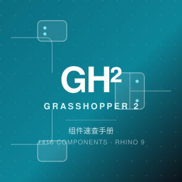

<p align="center">
  
</p>

<h1 align="center">Grasshopper 2 组件速查手册</h1>
<h3 align="center">GH2 Component Reference · Rhino 9</h3>

<p align="center">
  <b>1416 个官方组件 · 全中文速查 · 零依赖静态站</b><br />
  <sub>All 1416 official components &nbsp;·&nbsp; Chinese reference &nbsp;·&nbsp; zero-dependency static site</sub>
</p>

<p align="center">
  <a href="https://www.kbitai.com.cn/resources/AC_Tutorial/gh_guide/site/index.html"></a>
  
  
  
  
  
  
  
  
</p>

---

## 这是什么 · What is this

**中文** ｜ 一份把 Rhino 9 自带的 **Grasshopper 2** 全部 1416 个组件摊开、逐条译成中文的速查手册。核心是一个纯静态检索站：左侧分类树，中间组件卡片，点开看端口表；每个组件都带**原厂图标**、**输入输出端口**、**参数说明**和**可直接下载运行的官方示例**。配套 12 篇手写正文，补齐数据树、循环、脚本、排错这些"说明书里不讲"的部分。

**English** ｜ A complete, Chinese-translated reference for every one of the 1416 components shipped with **Grasshopper 2** in Rhino 9. The core is a static site: category tree on the left, component cards in the middle, port tables on click — each entry carries the **factory icon**, **input/output ports**, **parameter notes** and a **runnable official example**. Twelve hand-written articles cover data trees, looping, scripting and troubleshooting.

---

## 目录 · Table of Contents

| 章节 | Section |
|---|---|
| [特性](#特性--features) | [Features](#特性--features) |
| [组件分类](#组件分类--category-map) | [Category Map](#组件分类--category-map) |
| [快速开始](#快速开始--quick-start) | [Quick Start](#快速开始--quick-start) |
| [文档目录](#文档目录--documentation) | [Documentation](#文档目录--documentation) |
| [项目结构](#项目结构--structure) | [Structure](#项目结构--structure) |
| [数据模型](#数据模型--data-model) | [Data Model](#数据模型--data-model) |
| [构建流水线](#构建流水线--pipeline) | [Pipeline](#构建流水线--pipeline) |
| [已知限制](#已知限制--known-limitations) | [Known Limitations](#已知限制--known-limitations) |
| [许可与致谢](#许可与致谢--license--credits) | [License & Credits](#许可与致谢--license--credits) |

---

## 特性 · Features

| | 能力 Capability | 说明 Notes |
|---|---|---|
| 01 | **全量覆盖** Full coverage | 1416 / 1416，无遗漏、无占位 All components, no gaps |
| 02 | **原厂图标** Factory icons | 从 `Grasshopper2.dll` 内嵌的 807 个 `.ghicon` 渲染为 1416 张 PNG，非网络抓图 |
| 03 | **端口全表** Port tables | 名称 · 类型 · 必填 · 访问策略 · 中文说明，输入输出分列 |
| 04 | **中文命名** Chinese names | zhName 覆盖 77%（1090 / 1416），其余保留英文原名 |
| 05 | **示例直下** Examples | 204 个 `.ghz`，拖进 Rhino 即可运行 |
| 06 | **零依赖** Zero dependency | 纯 HTML / CSS / JS，无框架、无构建、无 CDN，双击即用 |
| 07 | **明暗双主题** Themes | 跟随系统偏好，一键切换 |
| 08 | **术语表** Glossary | 568 条官方术语，与组件正文互链 |

---

## 组件分类 · Category Map

| 分类 Category | 数量 | 分类 Category | 数量 |
|---|---:|---|---:|
| Curve 曲线 | 212 | Surface 曲面 | 157 |
| Maths 数学 | 183 | Data 数据 | 156 |
| Vector 向量 | 172 | Mesh 网格 | 129 |
| Params 参数 | 103 | Display 显示 | 94 |
| Transform 变换 | 89 | Intersect 相交 | 83 |
| Text 文字 | 38 | **合计 Total** | **1416** |

> 一级分类 11 个，二级分类 40+，与 Grasshopper 2 官方分类树完全一致。<br />
> 11 top-level and 40+ sub-categories, mirroring the official GH2 tree.

---

## 快速开始 · Quick Start

### 本地运行 / Run locally

```bash
git clone https://github.com/archilau0315/gh_guide.git
cd gh_guide
python -m http.server 8765
# 打开 http://localhost:8765/site/index.html
```

> 必须走 HTTP，`file://` 会被浏览器 CORS 拦截 `fetch`。任意静态服务器均可。<br />
> Serve over HTTP — `file://` is blocked by CORS. Any static server works.

### 部署 / Deploy

整目录拷进 Web 根目录即可，无构建步骤：

```bash
rsync -av --exclude=.git ./ user@host:/var/www/gh_guide/
```

---

## 文档目录 · Documentation

| 篇 Chapter | 标题 Title | 内容 |
|---|---|---|
| 01 | [安装与界面](doc/zh/01_quickstart/01_setup.md) | Rhino 9 安装、面板布局、首次连线 |
| 02 | [GH2 vs GH1](doc/zh/01_quickstart/02_gh2_vs_gh1.md) | 两代差异：类型系统、端口、数据结构 |
| 03 | [五个核心操作](doc/zh/01_quickstart/03_five_operations.md) | 放置、连线、分组、烘焙、预览 |
| 04 | [快捷键](doc/zh/01_quickstart/04_shortcuts.md) | 高频键位与自定义 |
| 05 | [数据树](doc/zh/03_datatree_meta/01_datatree.md) | Path、Branch、Graft、Flatten、Simplify |
| 06 | [重复策略](doc/zh/03_datatree_meta/02_repetition_strategies.md) | Item / List / Tree 三种访问模式 |
| 07 | [Metadata](doc/zh/03_datatree_meta/03_metadata.md) | GH2 新增的键值元数据体系 |
| 08 | [循环 Looping](doc/zh/04_loop_globals/01_looping.md) | GH2 原生循环组件 |
| 09 | [全局变量](doc/zh/04_loop_globals/02_globals.md) | Shout / Listen 跨分支传值 |
| 10 | [脚本组件](doc/zh/05_scripting/01_scripts.md) | Python 3 / C# 脚本片段 |
| 11 | [API 与 .gha](doc/zh/05_scripting/02_api_and_gha.md) | 插件开发入口与接口要点 |
| 12 | [排错清单](doc/zh/08_troubleshooting/01_troubleshooting.md) | 常见报错、空数据、类型不匹配 |

---

## 项目结构 · Structure

```text
gh_guide/
├── site/                        # 静态检索站 Static site
│   ├── index.html               # 入口 Entry
│   ├── style.css                # 样式 + 明暗主题 Styles + themes
│   ├── app.js                   # 检索、渲染、详情 Search & render
│   ├── assets/icons/*.png       # 1416 本地图标 Local icons
│   └── examples/*.ghz           # 204 官方示例 Official examples
│
├── data/                        # 结构化数据 Structured data
│   ├── components_full.json     # 组件 + 端口 + 描述 + zhName
│   ├── categories.json          # 11 一级分类 Category tree
│   ├── terms.json               # 568 术语 Glossary
│   ├── icon_map.json            # .ghicon 资源映射 Icon map
│   └── meta.json                # 版本元信息 Build metadata
│
├── assets/icons/{24,48,96}/     # 3 尺寸渲染图标 Rendered icons
├── doc/zh/                      # 12 篇正文 12 articles
├── tools/                       # 数据生产脚本 Data pipeline
├── cover.svg                    # 项目封面 Cover
├── dev_plan.md                  # 开发规划 Plan
└── debug_log.md                 # 变更日志 Changelog
```

---

## 数据模型 · Data Model

`data/components_full.json` 中每个组件长这样：

```json
{
  "id": "00000000-1959-4327-a3d8-bd076425d3bf",
  "id32": "0000000019594327a3d8bd076425d3bf",
  "name": "Bending Points",
  "zhName": "弯曲点",
  "cat1": "Curve",
  "cat2": "Analysis",
  "description": "Find the points of maximum curvature along a curve...",
  "inputs": [
    {
      "name": "Curve",
      "dir": "input",
      "facts": "item · required",
      "required": true,
      "description": "Curve to analyse."
    }
  ],
  "outputs": [],
  "examples": ["BendingPoints.ghz"],
  "url": "https://www.rhino3d.com/docs/grasshopper2/specs/00000000-1959-4327-a3d8-bd076425d3bf.html"
}
```

> 图标 URL 必须使用**带连字符的完整 GUID**，32 位无连字符形式在官方 CDN 上返回 404。<br />
> Icon URLs require the **hyphenated full GUID**; the 32-char form returns 404 on the official CDN.

---

## 构建流水线 · Pipeline

数据可复现，按顺序执行：

| 步骤 | 脚本 | 作用 |
|---|---|---|
| 1 | `tools/export_icons.py` | Rhino 9 内 IronPython 2 渲染 `.ghicon` → PNG（24 / 48 / 96） |
| 2 | `tools/parse-index.js` | 解析官方索引，生成 1416 组件骨架 |
| 3 | `tools/crawl-ports.js` | 抓取 1416 个详情页，正则提取输入输出端口 |
| 4 | `tools/enrich.js` | 下载官方预览图、复制 `.ghz`、补 zhName |
| 5 | `tools/match-icons.js` | 组件名 → `.ghicon` 资源名匹配 |
| 6 | `tools/parse-terms.js` | 解析 568 个 `.term` 文件生成术语表 |

```bash
node tools/parse-index.js && node tools/crawl-ports.js && node tools/enrich.js
```

数据更新后无需重新构建站点，刷新浏览器即可。<br />
No rebuild needed — the site reads JSON at runtime.

---

## 已知限制 · Known Limitations

- **zhDescription 尚未补全** — 目前只有中文名，组件描述仍为英文原文。Only Chinese names so far; descriptions remain English.
- **zhName 覆盖 77%** — 其余组件保留英文原名。Remaining components keep English names.
- **插件开发章节待写** — `doc/zh/06_plugin/` 为空目录。Plugin chapter pending.
- **文档仅中文** — 暂无 `doc/en/` 镜像。Chinese only for now.
- **PDF 版本未出** — 规划中。PDF export planned.

---

## 路线图 · Roadmap

| 阶段 | 目标 |
|---|---|
| v1.1 | zhDescription 批量翻译，补齐中文释义 |
| v1.2 | 中英双语切换（界面 + 正文） |
| v1.3 | `.gha` 插件开发章节 |
| v2.0 | PDF / 离线包导出 |

---

## 许可与致谢 · License & Credits

**版权归属**

- 组件图标、官方英文说明与术语，版权归 **Robert McNeel & Associates**
- 中文释义、代码与正文，版权归 **匡形无界 Kuanform Boundless Intelligent Technology**
- 图标与英文原文仅供学习查阅，**不得**用于商业再发布或二次分发
- 中文部分采用 **CC BY-NC 4.0**（署名 — 非商业性使用）

**作者**

- **Archilau（刘珂）** — 项目发起 · 数据梳理 · IronPython 2 调试 · 站点开发 · 文档写作
- 出版方：匡形无界 Kuanform Boundless Intelligent Technology

<p align="center">
  <sub>Built for architects and computational designers who read the manual so you don't have to.</sub><br />
  <sub>为读懂手册的人而做 · 2026</sub>
</p>
